# Joshua Xu — Engineering Projects

Electrical engineering graduate (BASc, University of British Columbia, 2026).
I work on how hardware is made, tested and qualified: process control,
semiconductor fabrication, power electronics and failure investigation.

[LinkedIn](https://www.linkedin.com/in/joshuaxuubc)

| Project | Area | Tools |
| --- | --- | --- |
| [SPC Analysis Toolkit](spc-toolkit/) | Statistical process control, DOE, AI-assisted analysis | Python, SciPy, MCP |
| [Thin-Film Microheater and RTD](microheater-rtd/) | Cleanroom fabrication and characterisation | KLayout, maskless lithography, PECVD |
| [45 nm CMOS RF and Analog Blocks](cmos-rf-analog/) | IC design and simulation | Cadence Virtuoso, Spectre |
| [Underwater Acoustic Energy Harvester](marine-energy-harvester/) | Power management design, layout and validation | Altium Designer, Python |
| [Laser Light Show Robot](laser-robot-motion-board/) | Encoder feedback, firmware and PID debugging | C firmware |
| [Reflow Oven Controller](reflow-oven-controller/) | 8051 firmware, thermocouple sensing, power control | 8051 assembly, Python |
| [Magnetic-Field-Controlled Robot](magnetic-field-robot/) | Wireless magnetic link, MCU firmware, motor drive | C, PIC32, EFM8, I2C |

---

## [SPC Analysis Toolkit](spc-toolkit/)

Ask a production dataset questions in plain English and get statistics you
can audit. Nine statistical process control tools (control limits, Western
Electric rules, Cp/Cpk, two-level factorial DOE, correlation, drift-vs-step
trend testing, windowed yield, charting) exposed to Claude Code over MCP. The
model chooses which analyses to run; every number comes from deterministic,
unit-tested Python.

Validated against faults planted at known values: 32 of 32 checks and 48 unit
tests pass. The DOE recovered a planted +8 temperature effect as +7.65 and a
+3 interaction as +2.64.

  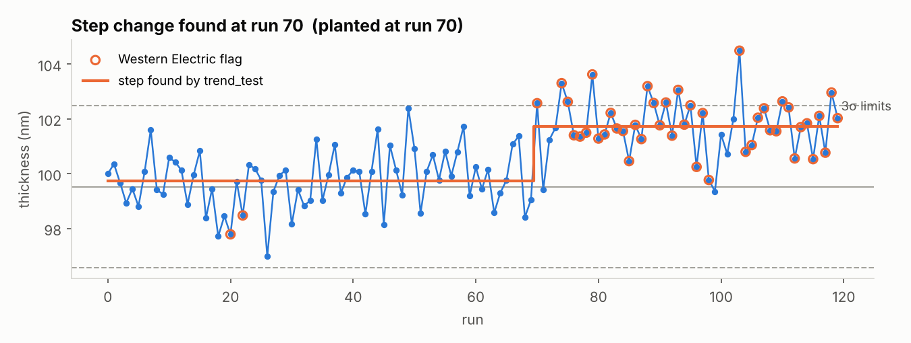
  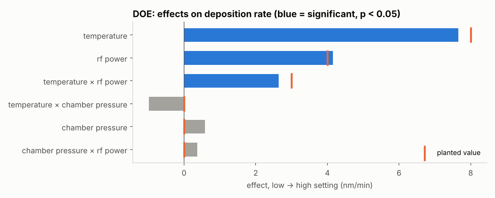

## [Thin-Film Microheater and RTD](microheater-rtd/)

A nickel microheater with an integrated resistance temperature detector,
taken from KLayout through the UBC cleanroom: maskless photolithography,
thermal evaporation with lift-off, PECVD silicon nitride and wet etch. I then
calibrated the RTD (TCR about 7.0 × 10⁻³ per °C), compared it against an
infrared camera, and worked through why the measured resistance was three
times the prediction.

  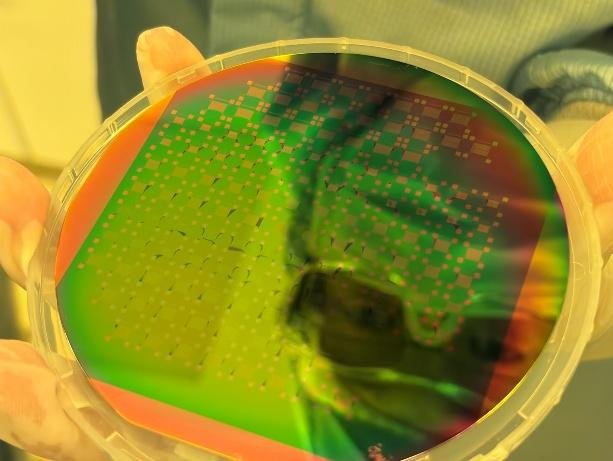
  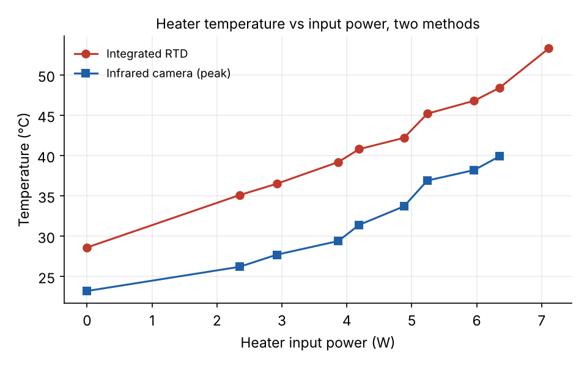

## [45 nm CMOS RF and Analog Blocks](cmos-rf-analog/)

Three circuits designed and simulated in Cadence, sized with the
gm/ID method:

- a 5.25 GHz cascode LNA with 18.3 dB gain and a 2.05 dB noise figure
- an LC VCO with −119.0 dBc/Hz phase noise at 1 MHz and an 11.1% tuning range
- a two-stage op-amp with 46.4 dB gain, 692 MHz unity-gain frequency and a
  63.8° phase margin

  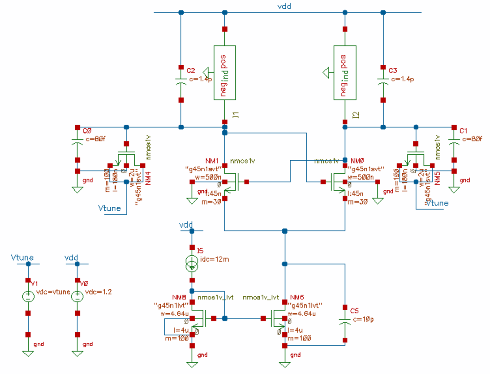
  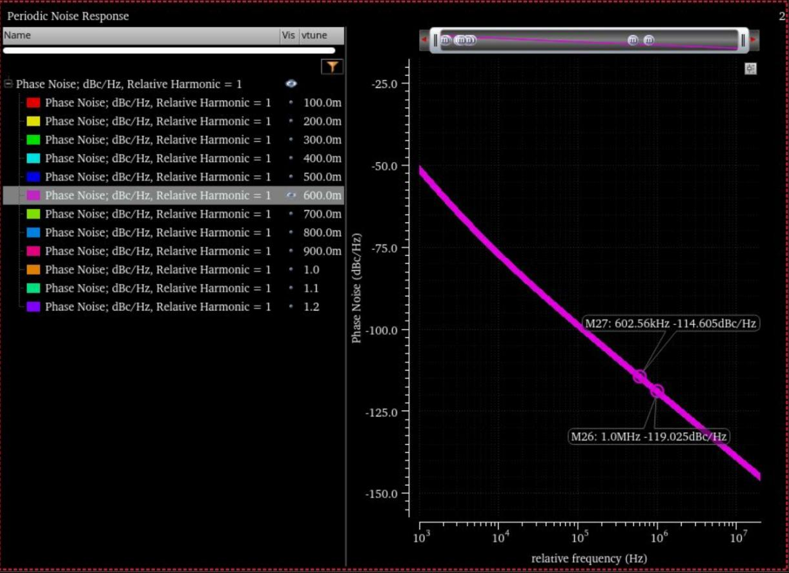

## [Underwater Acoustic Energy Harvester](marine-energy-harvester/)

Capstone project, team of five, sponsored through the NATO Science for Peace
and Security programme. The system harvests ship noise through a
piezoelectric transducer to power underwater sensors. I owned the BQ25570
boost converter and power management subsystem: IC selection, threshold
design, layout, a second revision with switchable current sensing, and the
validation plan.

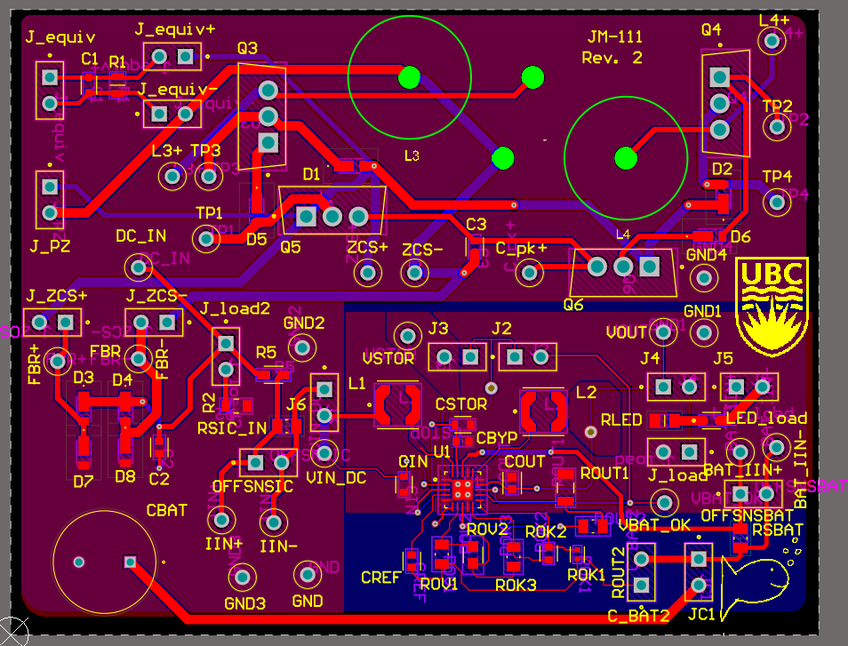

## [Laser Light Show Robot](laser-robot-motion-board/)

A two-axis robot that steers a laser through yaw and pitch gearboxes, with
encoder feedback and PID control on each axis, to trace shapes. Team of
five. I designed the encoder feedback that reports each axis's position and
debugged the firmware, including the PID position loop.

  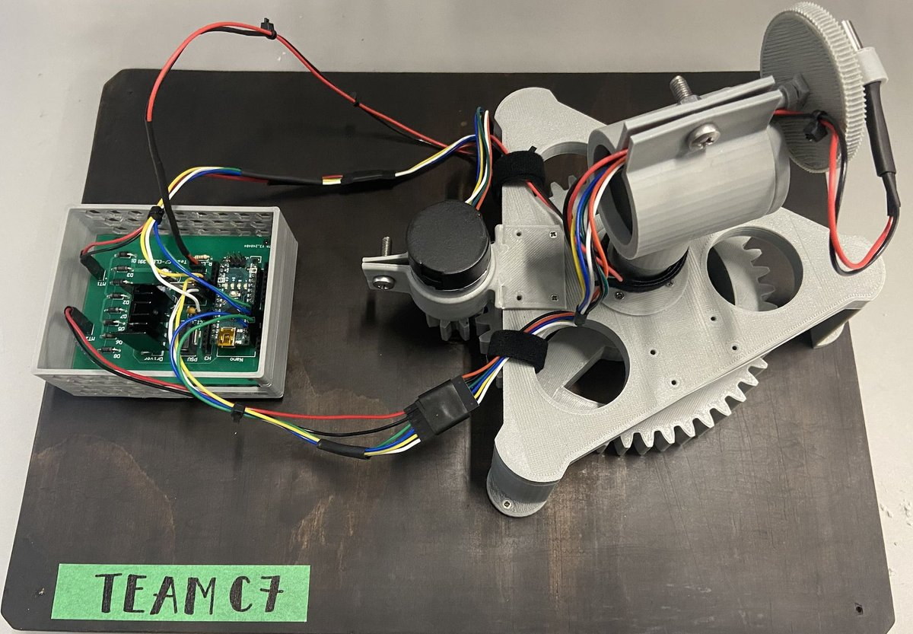
  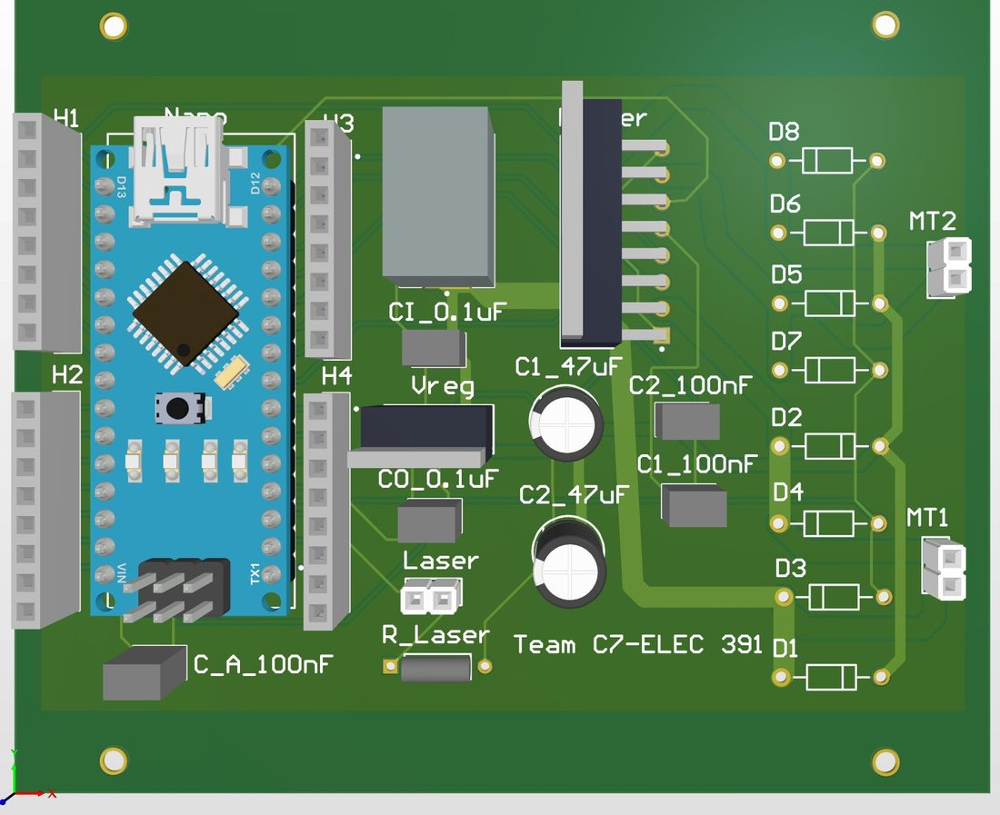

## [Reflow Oven Controller](reflow-oven-controller/)

An 8051 microcontroller that runs a toaster oven through a full solder
reflow profile: thermocouple and op-amp sensing into an SPI ADC, two
non-blocking state machines in 8051 assembly, PWM power control through a
solid-state relay, and an LCD and voice readout. It tracked a reference
thermometer to within about ±3 °C and baked boards successfully. Team of six.

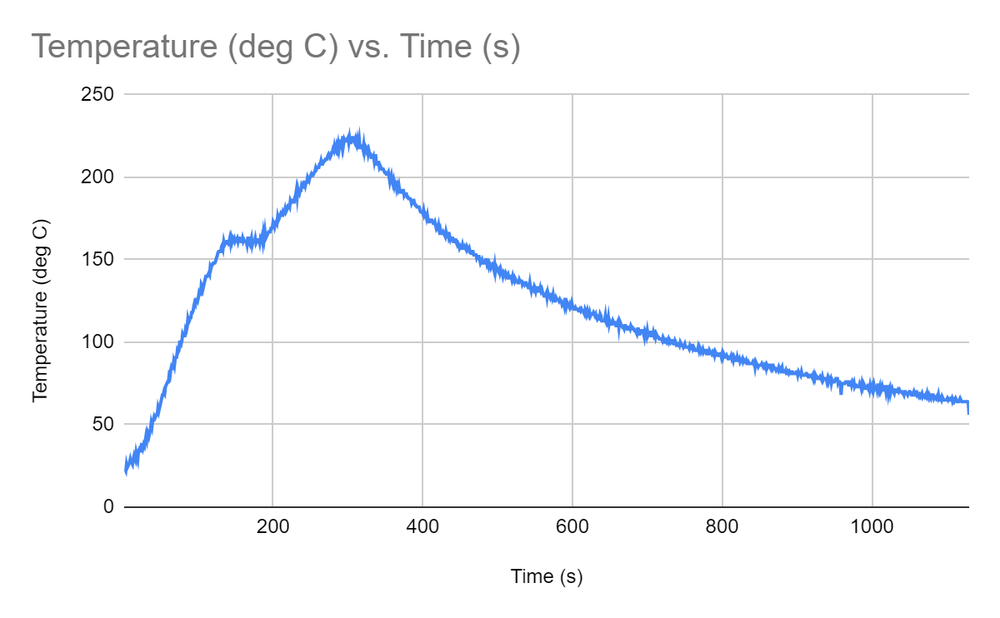

## [Magnetic-Field-Controlled Robot](magnetic-field-robot/)

A battery-powered robot steered by a magnetic field: an EFM8 transmitter
drives an LC tank at its 15.92 kHz resonance, and a PIC32 receiver decodes
frequency for commands and coil voltage for distance. It reached 130 cm in
command mode and held a 50–60 cm tracking distance. Team of six.

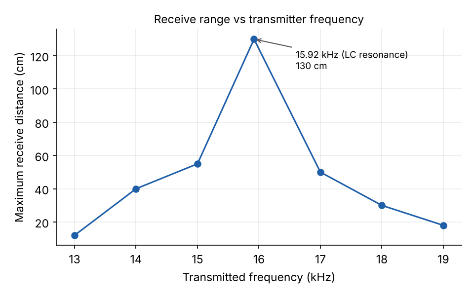
