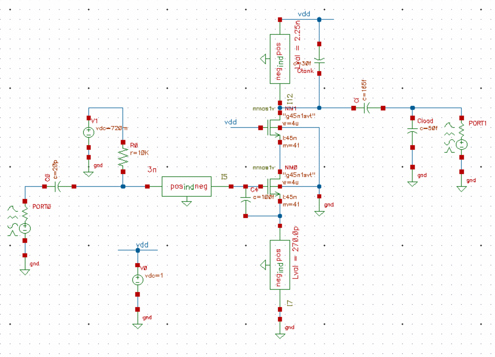
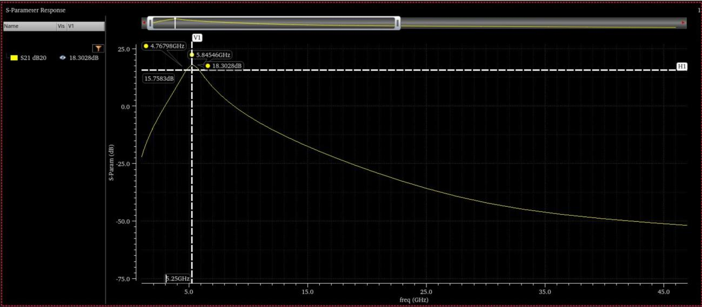
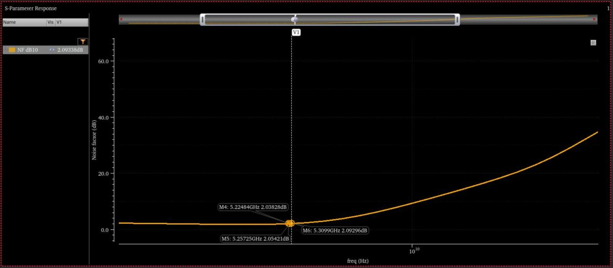
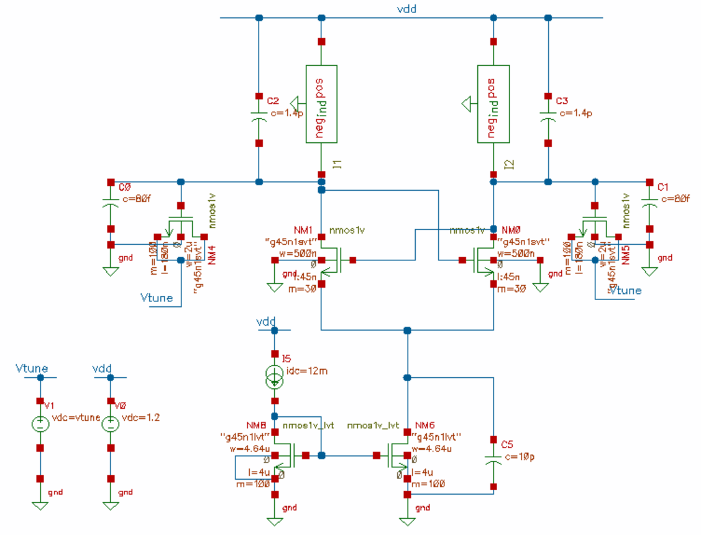
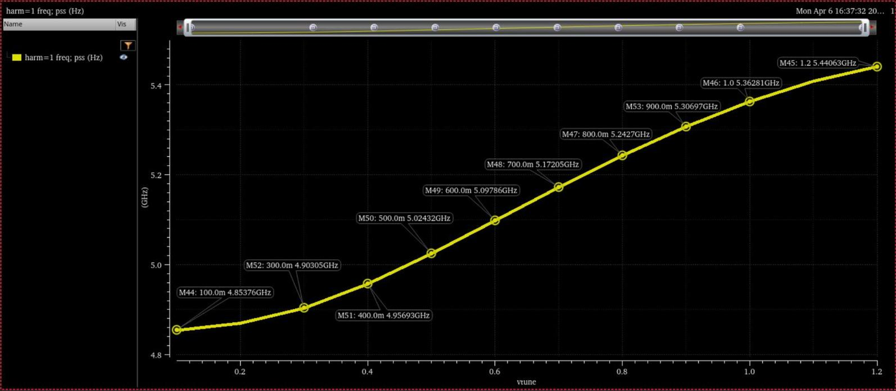
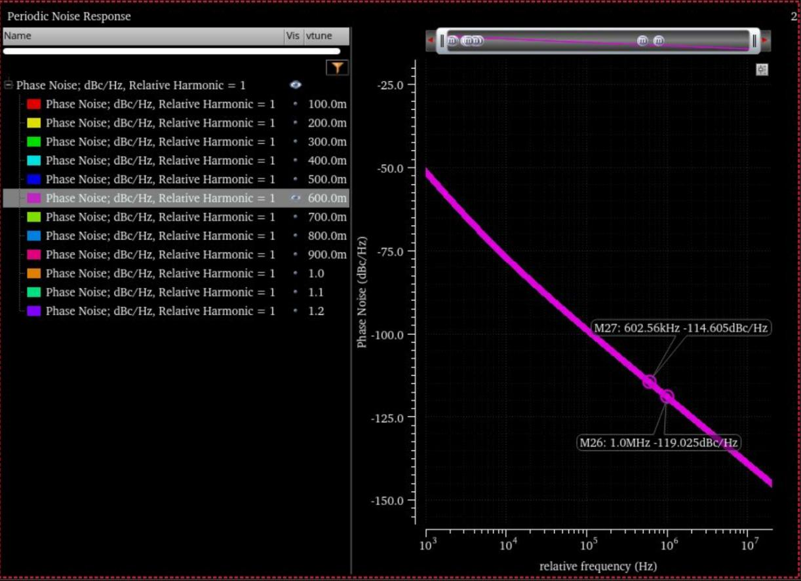
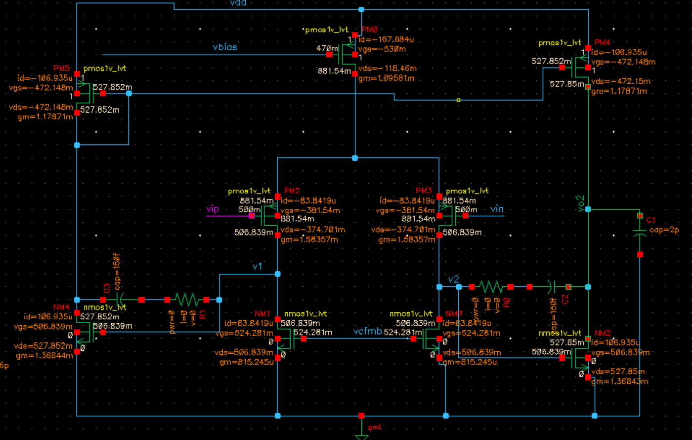
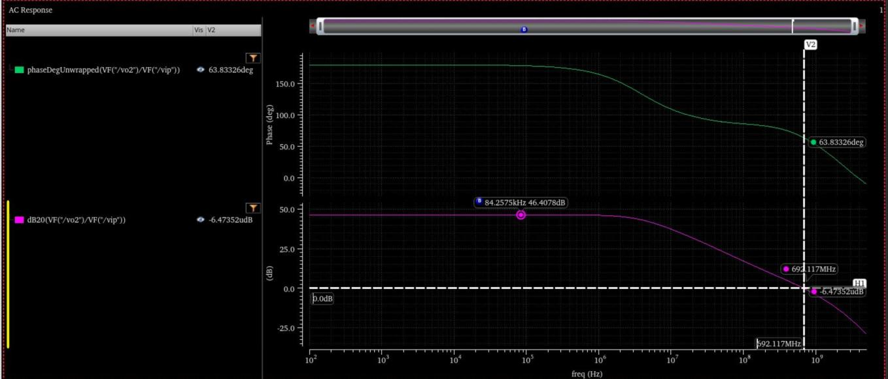

# 45 nm CMOS RF and Analog Blocks

University of British Columbia, Dec 2025–Apr 2026: Analog CMOS IC Design
(ELEC 401) and RF Integrated Circuits (ELEC 404). [← All projects](../README.md)

Three circuits designed and simulated at schematic level in the gpdk 45 nm
CMOS process, using Cadence Virtuoso and Spectre. All three were sized with
the gm/ID method: I characterised the transistors in simulation first,
because the square law is inaccurate at these channel lengths.

| Block | Key result |
| --- | --- |
| [Cascode low-noise amplifier](#cascode-low-noise-amplifier-525-ghz) | 18.3 dB gain, 2.05 dB noise figure at 5.25 GHz |
| [LC voltage-controlled oscillator](#cross-coupled-lc-vco) | −119.0 dBc/Hz phase noise at 1 MHz offset, 11.1% tuning range |
| [Two-stage op-amp](#two-stage-op-amp) | 46.4 dB gain, 692 MHz unity-gain frequency, 63.8° phase margin |

---

## Cascode low-noise amplifier, 5.25 GHz

An inductively degenerated cascode common-source LNA on a 1.0 V supply,
driving a 50 fF load.

| Specification (±100 MHz) | Target | Simulated |
| --- | --- | --- |
| Gain S21 | > 15 dB | 18.3 dB |
| Noise figure | < 2.2 dB | 2.05 dB |
| Input match S11 | < −10 dB | −11.1 dB |
| Output match S22 | < −10 dB | −12.4 dB |
| Reverse isolation S12 | < −30 dB | −38.2 dB |

- **Inductors:** I chose the 2.25 nH drain inductor by sweeping the supplied
  on-chip inductor model, including its substrate parasitics, for the best
  parallel resistance at a usable Q. I checked that its self-resonance
  (about 9.8 GHz) sat well above the operating band.
- **Input match:** the first pass resonated near 5.7 GHz, not 5.25 GHz, and
  S11 was poor. Adding an external gate-source capacitor fixed the match
  without widening the transistor, which kept power at about 6 mW.

  
  

## Cross-coupled LC VCO

An NMOS cross-coupled oscillator with varactor tuning on a 1.2 V supply,
targeting 5.25 GHz.

| Specification | Target | Simulated |
| --- | --- | --- |
| Phase noise at 1 MHz offset | better than −118 dBc/Hz | −119.0 dBc/Hz |
| Tuning range | > 10% | 11.08%, centred at 5.145 GHz |

- **First pass:** hand analysis led to a 1.12 nH inductor. It started up
  and tuned correctly but missed the phase-noise spec by about 30 dB.
- **Redesign:** I moved to a 500 pH inductor to leave capacitive headroom
  for 200 µm varactors, and raised the tail current from 2.25 mA to 6.7 mA
  to make up for the lower tank resistance. I deliberately ran the tail
  transistor in triode so the core could swing further within 1.2 V, and
  added a 10 pF bypass capacitor to cut noise upconversion.

  
  

## Two-stage op-amp

A differential-input, single-ended-output two-stage op-amp with PMOS inputs,
Miller compensation with a nulling resistor, and a low-power common-mode
feedback loop. It was an optional project and my first use of Cadence
Virtuoso; I taught myself the tool to do it.

| Specification | Target | Simulated |
| --- | --- | --- |
| Open-loop gain | ≥ 46 dB | 46.4 dB |
| Unity-gain frequency | ≥ 600 MHz | 692 MHz |
| Phase margin | 60–90° | 63.8° |
| Power (op-amp + CMFB) | ≤ 440 µW | 412 µW |

- **Compensation:** I sized the nulling resistor to place the compensation
  zero over the second-stage pole.
- **Closed loop:** −3 dB bandwidth of 435 MHz, 10–90% settling in about
  0.3 ns, and slew rates of about 143 and 148 V/µs.

**Scope:** schematic design and simulation only. No physical layout or
post-layout extraction was done.
