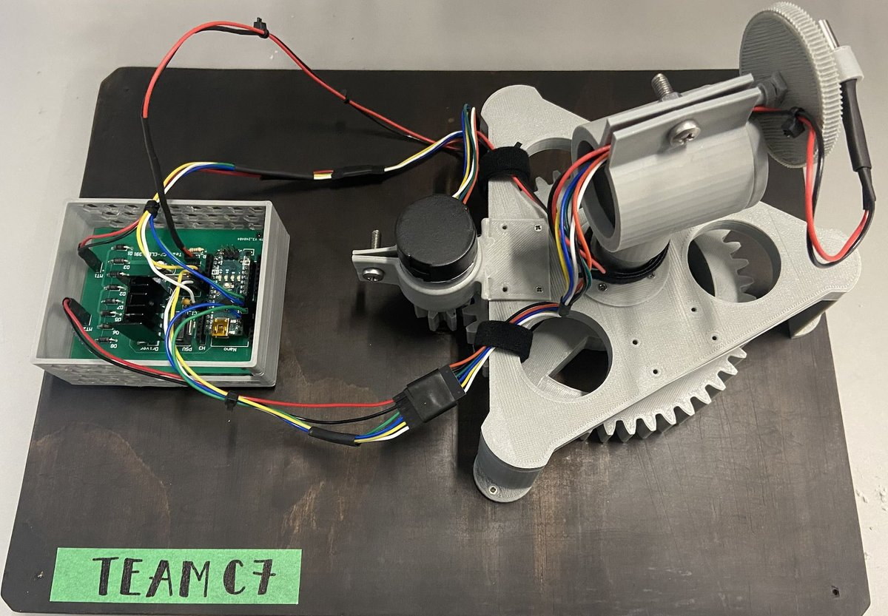
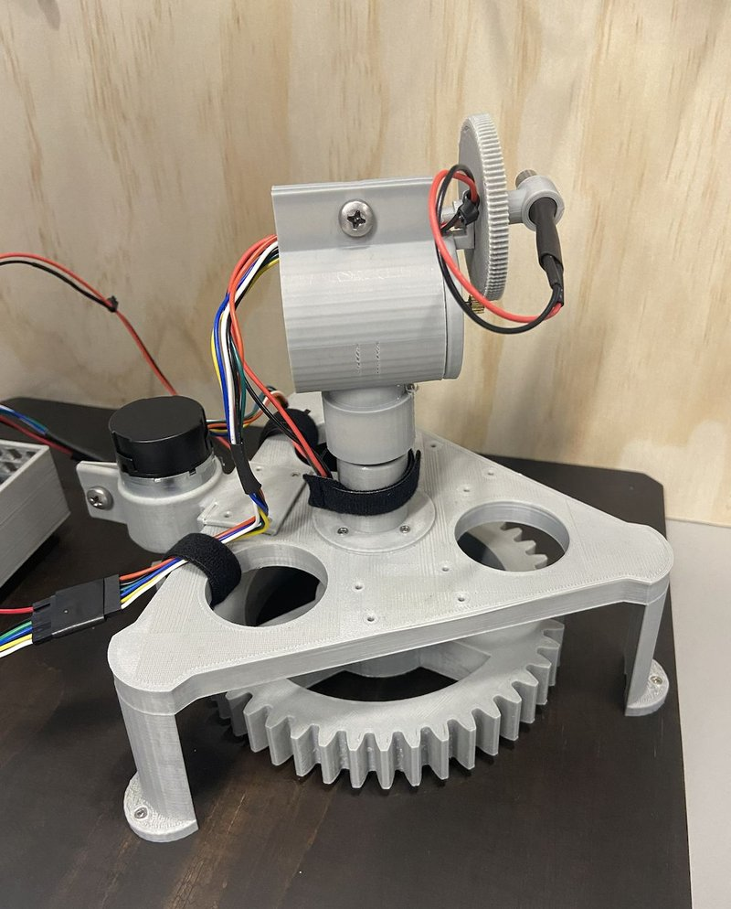
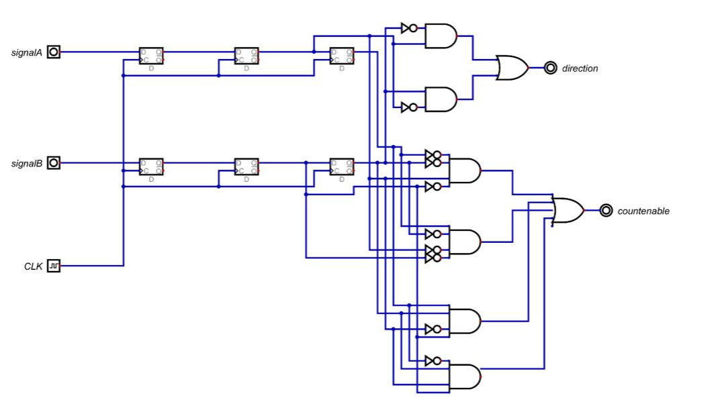
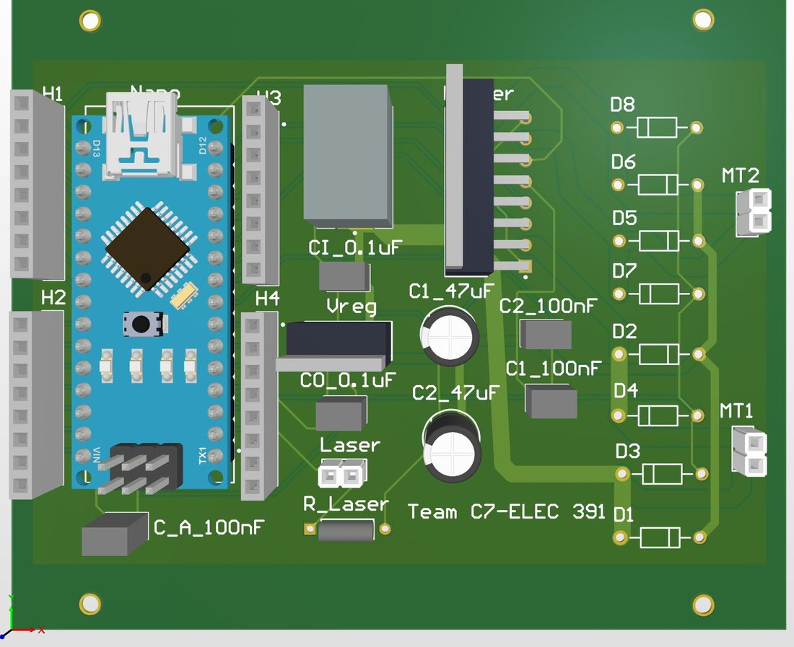
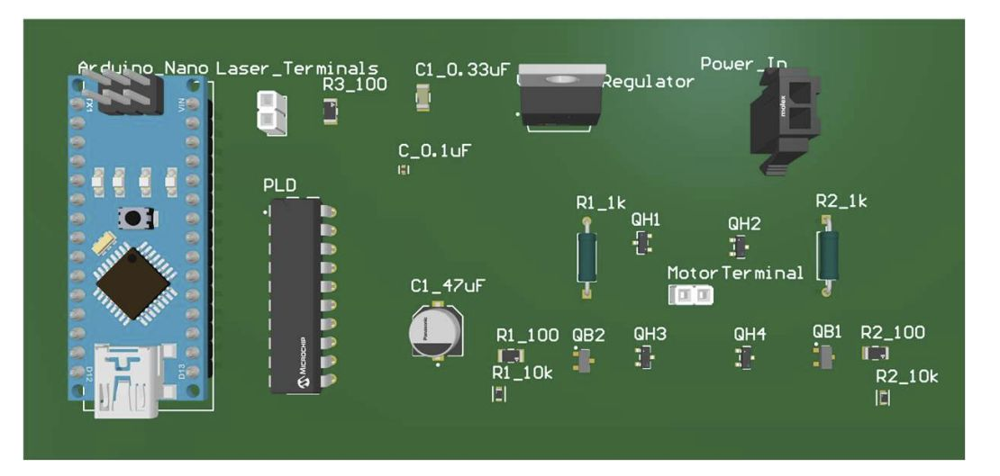
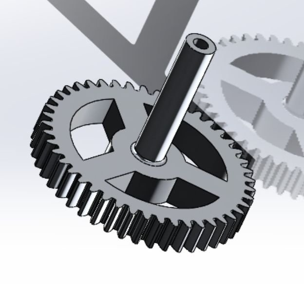
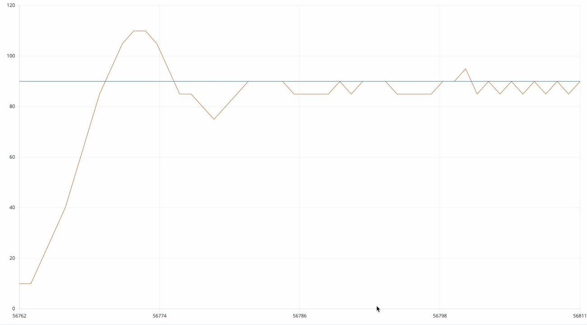

# Laser Light Show Robot

ELEC 391, University of British Columbia, Feb–Apr 2024. Team C7, five
people. [← All projects](../README.md)

A two-axis robot that steers a laser to trace shapes. Motors turn the yaw
and pitch axes through gearboxes, encoders report position, and a
PID loop on each axis drives the laser to a sequence of target points.

  
  

## My part: encoder feedback and firmware debugging

- **Encoder feedback:** I designed the encoder feedback, which reports the
  position of each axis to the controller. Yaw uses a 360 CPR encoder and
  pitch a 640 CPR encoder, and their quadrature signals are decoded into
  direction and count.
- **Firmware debugging:** I debugged the firmware, including the PID
  position loop on each axis.

## The rest of the system (team work)

**Control board.** A custom multilayer board with an H-bridge motor driver,
encoder inputs and on-board power regulation, carrying the microcontroller
and the laser output.

  
  

**Gearboxes.** Gear trains step the motors down on each axis: an 8-tooth
pinion driving a 45-tooth gear on yaw, and a 10-tooth pinion driving a
100-tooth gear on pitch.

**Control tuning.** Each axis was tuned in stages, P → PD → PI → PID. The
demo constants were Kp = 2, Ki = 0.02, Kd = 0.1 on yaw and Kp = 0.1,
Ki = 0.01, Kd = 0.01 on pitch.

*Position (orange) responding to a step in setpoint (blue), captured while
tuning.*

**Drawing shapes.** A shape is stored as a list of (x, y) points on the
projection plane. Each point becomes a target angle on each axis through
θ = atan(coordinate / z), where z is the distance to the plane. The
controller holds each point until the setpoint is reached, then moves to the
next.
