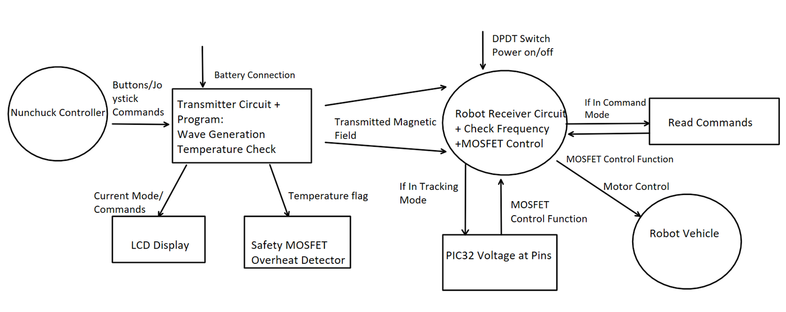
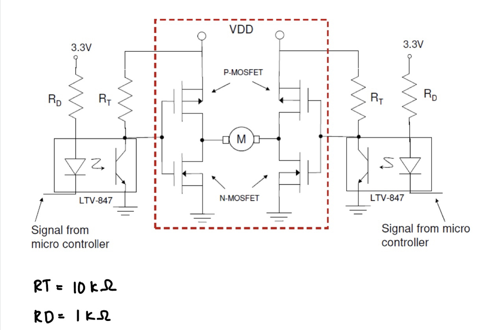
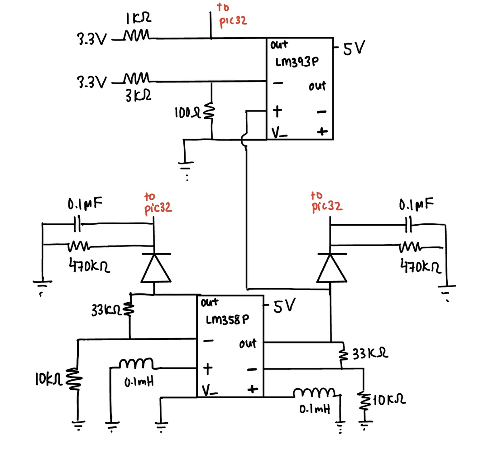
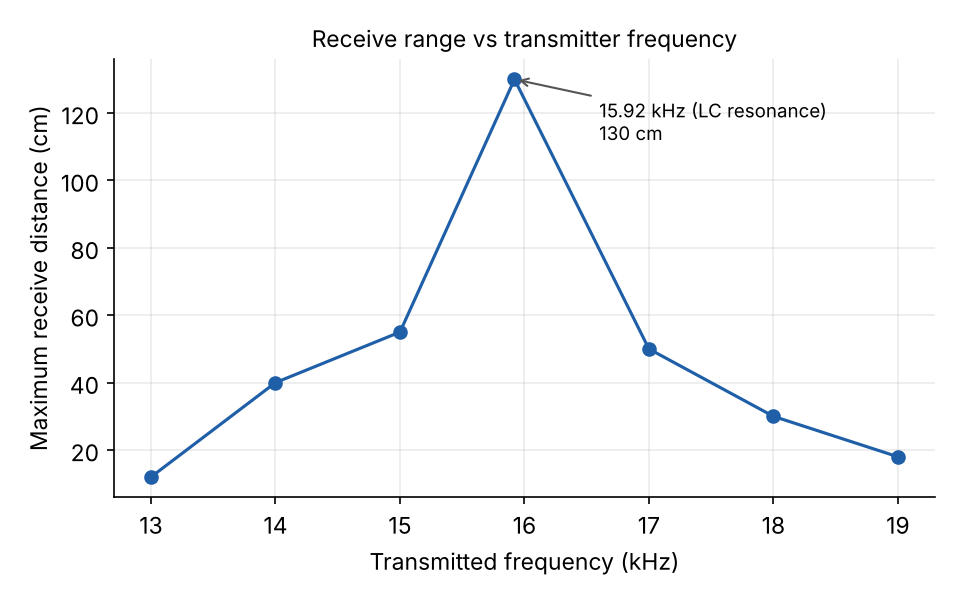
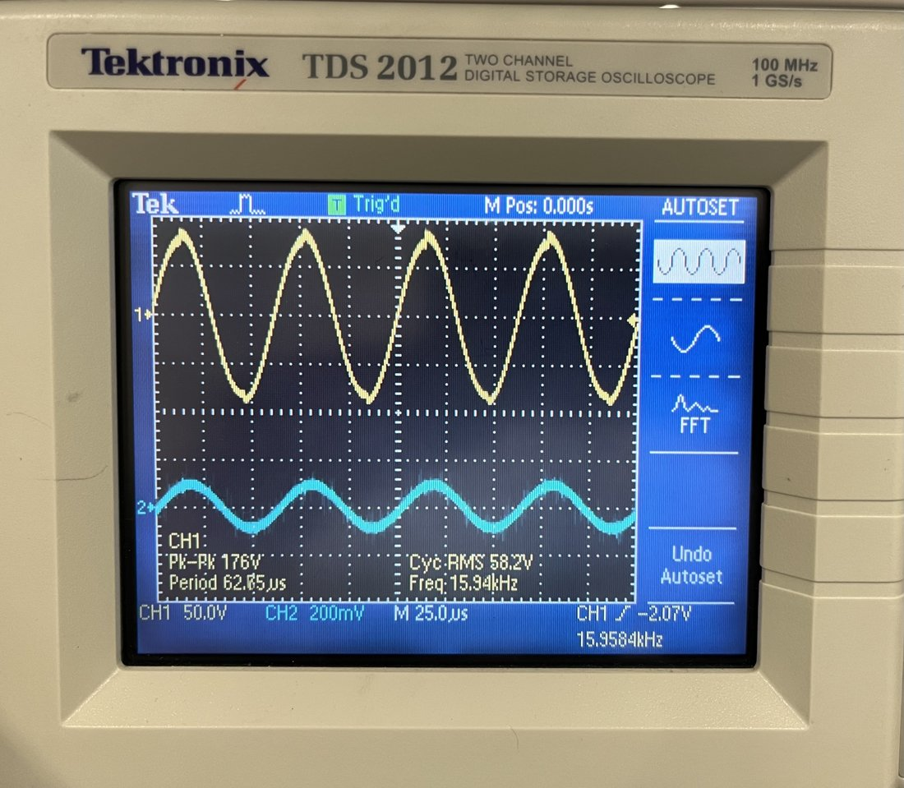

# Magnetic-Field-Controlled Robot

ELEC 291, University of British Columbia, 2023 (report submitted April 2023). Team of six.
[← All projects](../README.md)

A battery-powered robot steered entirely by a magnetic field. A hand-held
transmitter drives an LC tank to radiate an alternating magnetic field; the
robot's pickup coils sense it, and its firmware decodes the frequency and
strength to either follow commands or hold a set distance from the
transmitter.

I worked across every part of the system with the team: the transmitter and
receiver firmware in C, the Nunchuk joystick interface, the H-bridge motor
drive and the receiver circuit tuning.

## Two modes

- **Command mode:** each joystick direction is sent as its own frequency
  (15.0 kHz idle, 16.0 kHz forward, 15.6 kHz back, 15.8 kHz left, 15.7 kHz
  right). The robot measures the received frequency and drives its motors.
- **Tracking mode:** the transmitter sends the resonant frequency, and the
  robot uses the received voltage on its left and right coils to hold a fixed
  distance and turn towards the transmitter.

## Transmitter

- **MCU:** an EFM8 generates square waves on a hardware timer, set from the
  Nunchuk joystick read over I2C, with a button to switch modes and an LCD
  showing the current mode and command.
- **Drive:** BJTs level-shift the 3.3 V logic to 9 V for an H-bridge, which
  drives an LC tank (1 mH, 0.1 µF) resonant at about 15.92 kHz.

## Receiver robot

- **MCU:** a PIC32MX130 measures the received frequency, reads the coil
  voltages through its ADC and drives the motors.
- **Front end:** two pickup inductors feed an LM358 amplifier and an LM393
  comparator, giving the MCU both a clean square wave for frequency and an
  analog level for distance.
- **Motors:** two H-bridges, isolated from the logic by LTV846 optocouplers.
  An overheat sensor protects the MOSFETs.

## Results

We measured how far the robot could still receive at each transmitter
frequency. Range peaked sharply at the LC resonance, so the design was built
around 15.92 kHz, with the command frequencies kept close to it.

- **Command mode:** responsive to every joystick direction, with a maximum
  range of 130 cm.
- **Tracking mode:** held a fixed distance in the 50–60 cm range.
- **What we fixed along the way:** repeated MOSFET and board failures, motors
  that barely spun (fixed in both hardware and firmware), and noisy ADC
  readings caused by the coils wobbling, cured by stabilising and
  recalibrating them.

*Transmitter (yellow) and received signal (blue) at about 15.95 kHz.*
