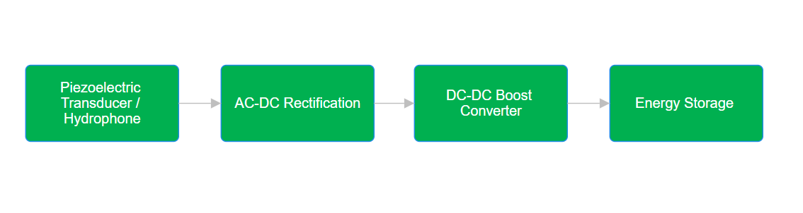
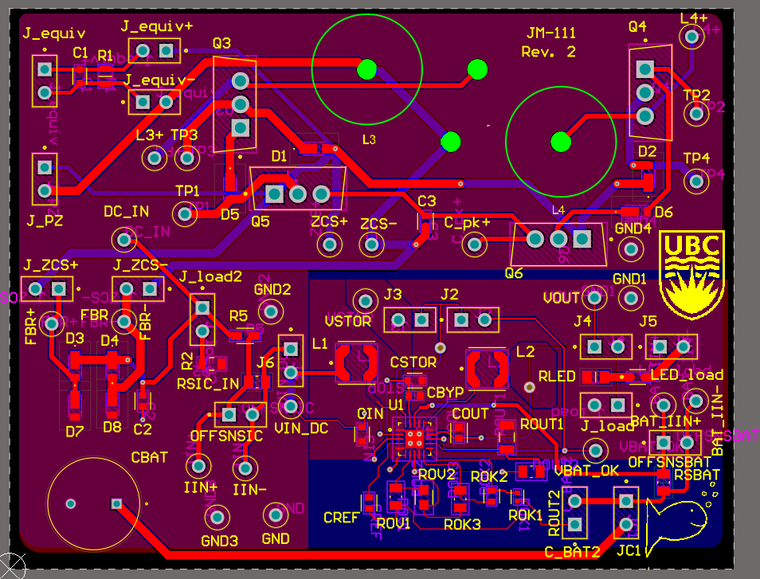
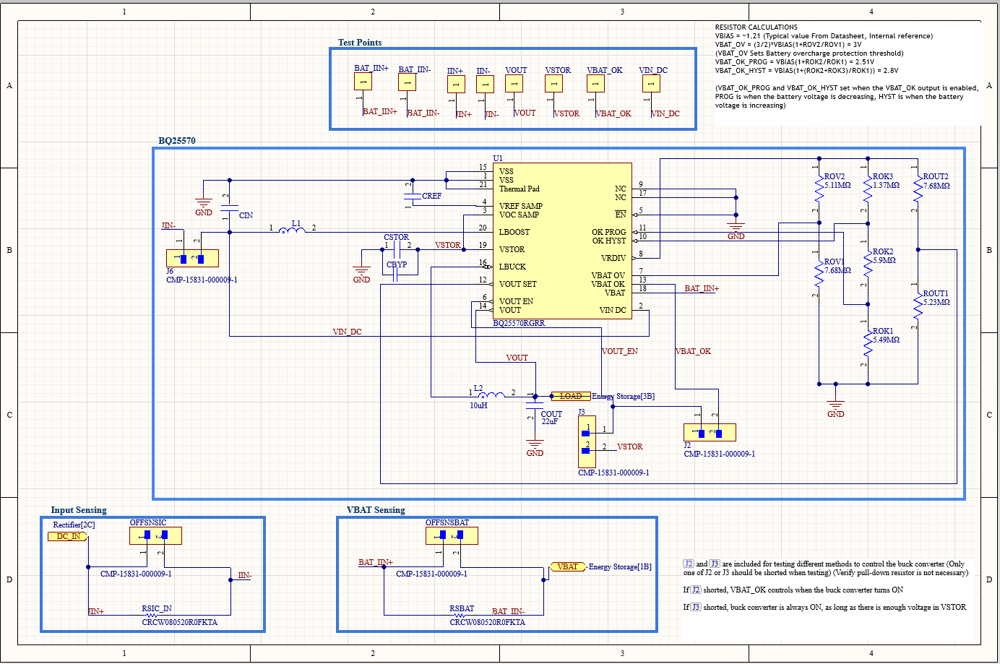
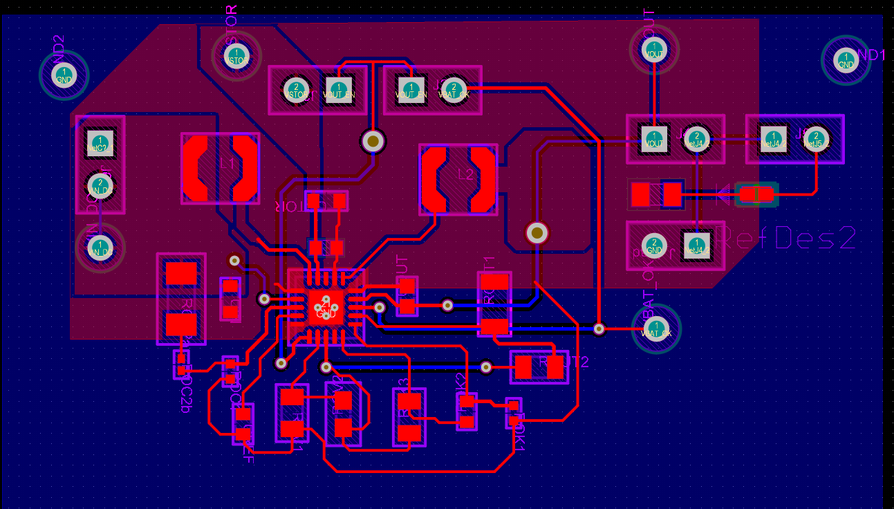

# Underwater Acoustic Energy Harvester

Capstone project JM-111, University of British Columbia, Sep 2025–Apr 2026.
Team of five, sponsored through the NATO Science for Peace and Security
programme. [← All projects](../README.md)

Internet of Underwater Things sensors currently need a lot of maintenance
to keep powered. This system harvests energy from the acoustic noise of
passing ships. A piezoelectric transducer converts the sound to an AC signal
of only millivolts, a P-SSHI rectifier converts it to DC, a boost converter
raises it to a usable voltage, and a supercapacitor stores it.

**My part was the DC-DC boost converter and power management subsystem**,
from choosing the IC through schematic, layout, bring-up and validation.

*The Rev. 2 board. My subsystem is the BQ25570 section at lower right; the
P-SSHI rectifier in the upper half belongs to a teammate.*

## Choosing the IC

With an eight-month schedule, we used a dedicated energy-harvesting IC rather
than a discrete design, to get maximum power point tracking (MPPT), cold
start and charge control built in. I evaluated three ICs, the Analog Devices
ADP5090 and the Texas Instruments BQ25504 and BQ25570, on cold-start voltage, quiescent
current, input range, programmability and layout guidance.

I chose the **BQ25570** for two reasons. Its built-in buck converter
regulates the output to the load, and its enable pins let us switch parts of
the IC on and off. A collaborator's earlier BQ25504 prototype board also gave
us a working baseline for schematic and layout.

## Design

- **Thresholds:** I set the IC's resistor-programmed thresholds for the
  supercapacitor: overcharge protection at 3.0 V, and the VBAT_OK output at
  2.51 V falling and 2.8 V rising, with a 3.0 V regulated output. VBAT_OK
  drives the buck converter's enable, so the load is powered only once the
  supercapacitor has charged enough.
- **Layout (Altium Designer):** the boost and buck power grounds are kept
  separate and join only at the IC's thermal pad, to keep switching noise
  apart. The board uses JLCPCB design rules, with test points and jumpers
  (J2, J3, J6) to isolate sections during testing.

## Revision 2

- **MPPT setting:** I moved the operating point from 40% to 80% of the
  sampled open-circuit voltage. 40% suits a piezo feeding a plain rectifier,
  but P-SSHI changes where the maximum power point sits.
- **Current sensing:** I added sense resistors at the IC input and at the
  storage element, each switchable with a jumper (OFFSNSIC, OFFSNSBAT), so we
  could measure current and power at both points.
- **Lesson for next time:** MPPT is set by surface-mount resistors, so every
  change means rework. A future design should make those values easy to
  swap.

*The boost converter prototype layout in Altium.*

## Measuring very low input power

At these power levels, oscilloscope noise is not negligible next to the
signal. We captured 100-second records of voltage and current with
differential probes and wrote a Python script that multiplies them and
integrates over the whole record, so the noise averages towards zero and the
real input power stands out.

## Validation and debugging

- **Power budget:** I built the power budget showing an intermittent marine
  source could run the load.
- **Validation plan:** I wrote and ran the validation plan, mapping every
  requirement to an instrument setup and a pass/fail criterion.
- **A two-week regulation failure:** I traced it to floating transistor
  gates in the upstream stage, cleared my own subsystem, and handed the fix
  to the team that owned that stage.

I also hosted the weekly project meeting, keeping five people aligned on the
interfaces between subsystems and on schedule.
