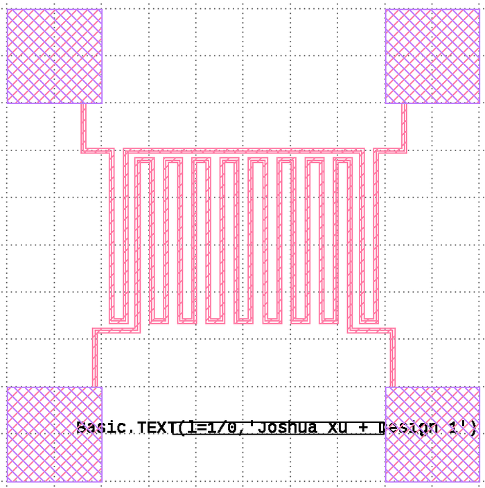
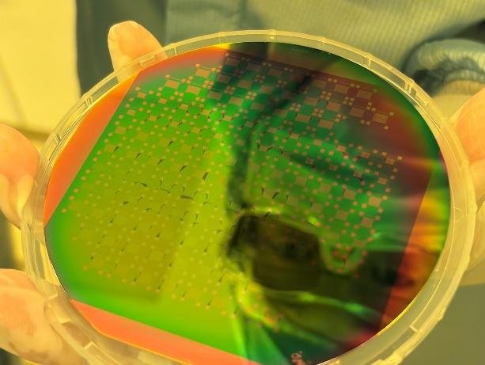
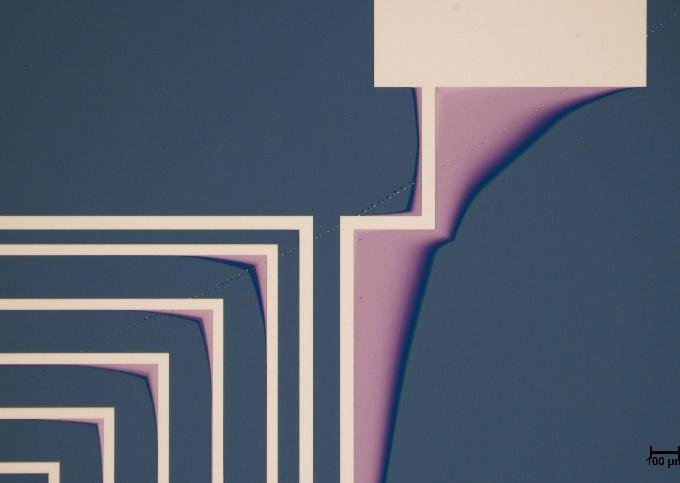
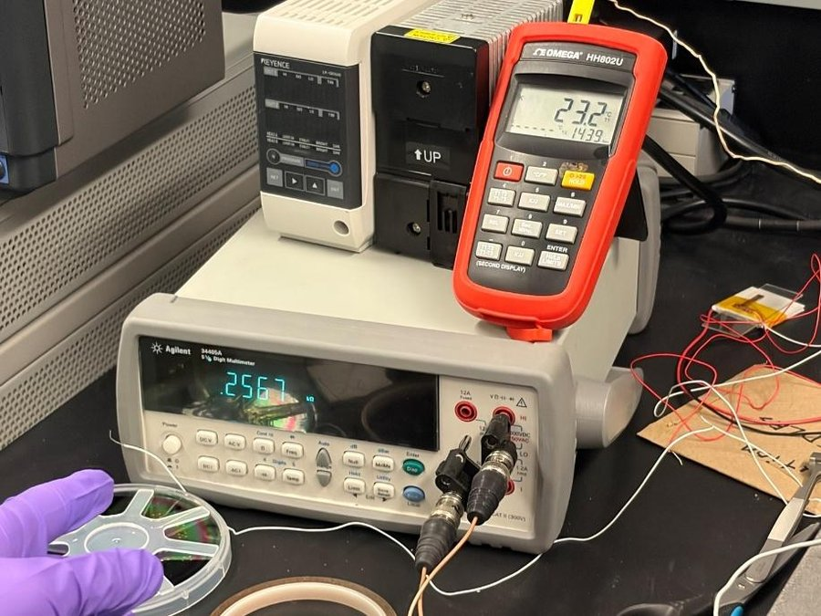
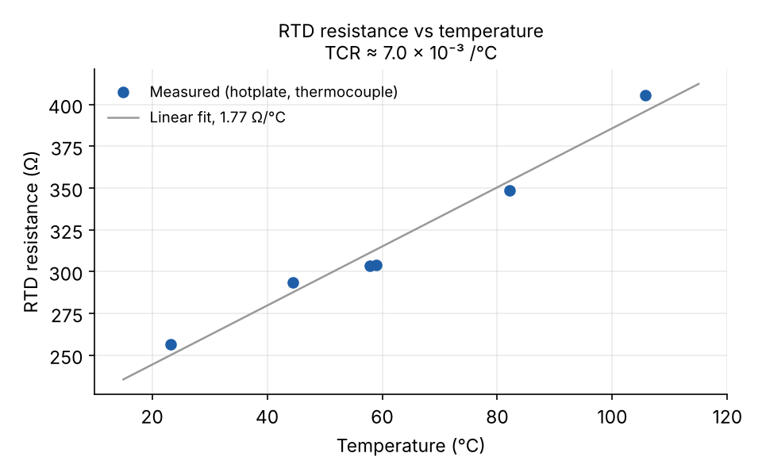
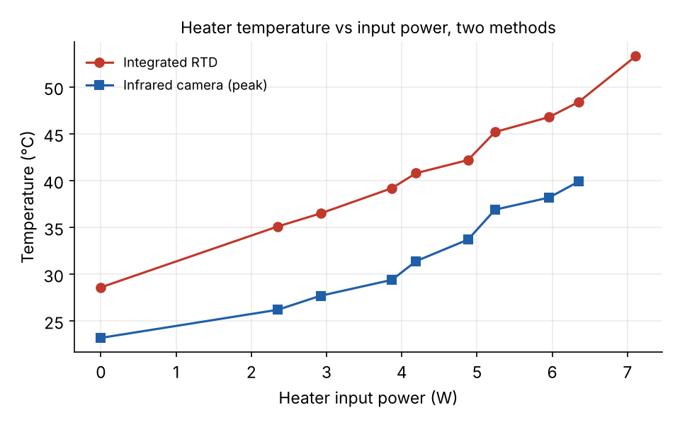

# Thin-Film Microheater and RTD

ELEC 463 Micro/Nanofabrication Lab, University of British Columbia, Jan–Apr 2026.
[← All projects](../README.md)

A nickel microheater with an integrated resistance temperature detector
(RTD), designed in KLayout and fabricated, measured and characterised in the
UBC cleanroom over six lab sessions.

  
  

| | |
| --- | --- |
| **Stack** | Si / SiO2 / 10 nm Cr adhesion + 100 nm Ni / Si3N4 passivation (100 nm target) |
| **Design** | Serpentine heater with the RTD placed above it in a 6 mm × 6 mm area, four pads, ≥20 µm features and spacing |
| **Tools** | KLayout, Heidelberg MLA150 maskless aligner, Kurt J. Lesker thermal evaporator, Trion PECVD, Filmetrics reflectometer, DektakXT profilometer, four-point probe, infrared camera |

## Process flow

1. **Photolithography:** solvent clean, dehydration bake, HMDS, AZ5214
   positive resist, direct-write exposure on the MLA150, develop in AZ 300
   MIF. The Dektak measured the resist at about 788 nm.
2. **Metal deposition and lift-off:** 10 nm Cr then 100 nm Ni by thermal
   evaporation without breaking vacuum, thickness tracked by quartz crystal
   microbalance, then lift-off in acetone.
3. **Passivation:** PECVD silicon nitride (silane, ammonia and nitrogen at
   about 300 °C).
4. **Second photolithography** to open windows over the contact pads.
5. **Wet nitride etch**, about 300–350 s including a deliberate over-etch,
   confirmed with Filmetrics and Dektak.

Deposition and etch times were set from rates calibrated on dummy wafers
(a ~500 s test deposition and a ~100 s test etch), measured by reflectometry.

  
  

## Characterisation

**RTD calibration.** I measured RTD resistance against temperature on a
hotplate with a thermocouple reference. It rose linearly from 256.7 Ω at
23.2 °C to 405.7 Ω at 105.7 °C, giving a temperature coefficient of
resistance of about 7.0 × 10⁻³ per °C. That is higher than bulk values,
which points to thin-film effects and two-wire contact resistance.

**Heater temperature, two ways.** I powered the heater in steps and read the
temperature from both an infrared camera and the integrated RTD, using the
calibration above. Both rise steadily with power. The RTD reads higher
throughout, because it senses the device locally while the camera depends on
the emissivity of thin metal and nitride, and the two do not look at the same
point on a device with thermal gradients.

## What did not match, and why

- **Resistance about 3× the prediction.** The four-point probe gave a sheet
  resistance of 0.359 Ω/sq. With a heater length-to-width ratio of 232, that
  predicts 83.3 Ω, but the device measured 256.7 Ω. The likely causes are
  linewidth reduction and corner rounding in the patterned lines, film
  non-uniformity, contact resistance, and a sheet resistance taken without a
  dedicated van der Pauw test structure.
- **Nitride thickness.** Filmetrics measured about 1118 nm against a 100 nm
  target, roughly ten times over. The likely causes are the deposition time,
  an error in the dummy-wafer rate calibration, or a mismatch between the
  dummy and device wafers.
- **Pad openings.** I found that the window over each pad was drawn about the
  same size as the pad itself, which leaves no room for alignment error
  between the two lithography steps. It should be drawn larger.

Data from my lab report; plots regenerated from its measurement tables.
