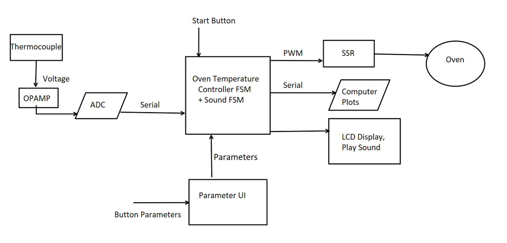
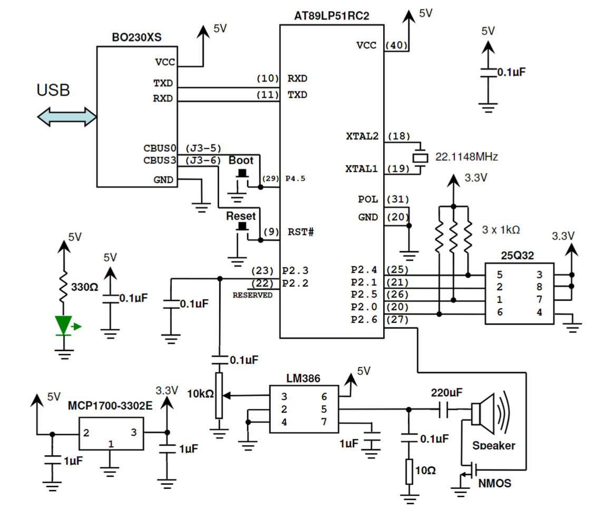
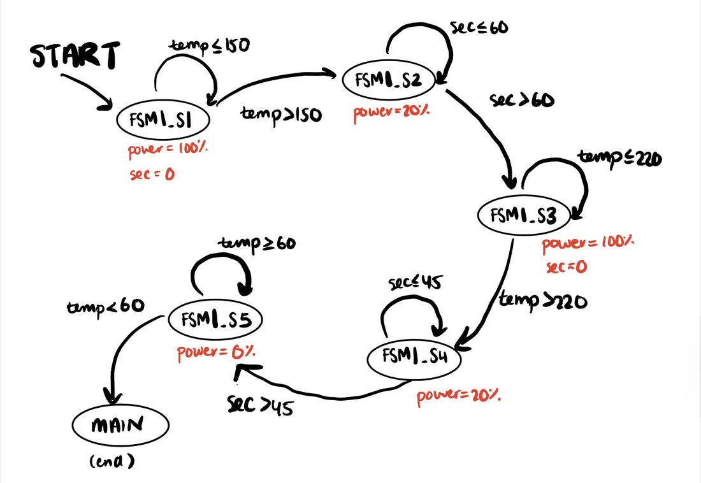
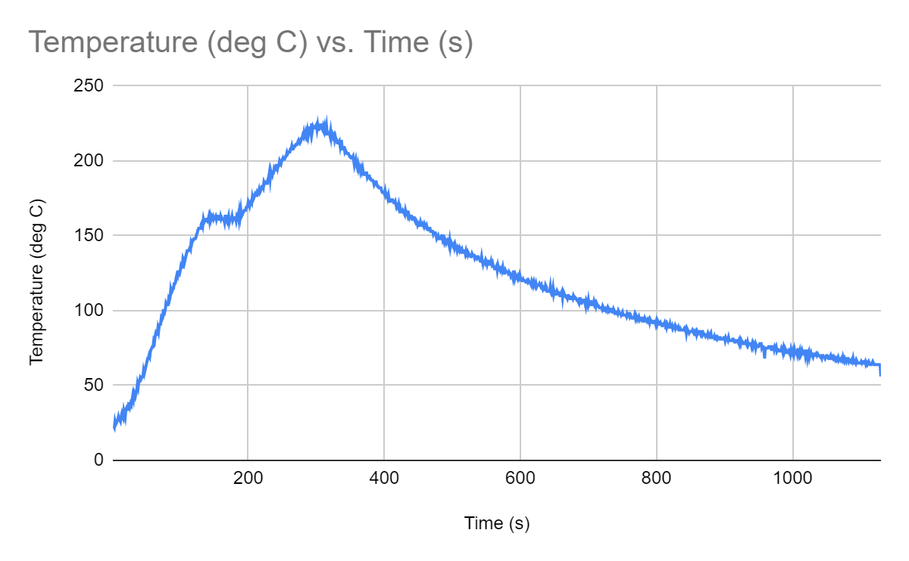

# Reflow Oven Controller

ELEC 291, University of British Columbia, 2023 (report submitted March 2023). Team of six.
[← All projects](../README.md)

A controller that turns a toaster oven into a reflow oven for soldering
circuit boards. An 8051 microcontroller (AT89LP51RC2) reads a thermocouple,
runs the reflow profile as a state machine in 8051 assembly, switches the
oven through a solid-state relay, and reports temperature on an LCD, over
serial and by voice.

I worked across every part of the system with the team: the assembly
firmware and state machines, the thermocouple amplifier and ADC conversion,
the LCD and audio, and the serial logging used to validate it.

## Hardware

- **Temperature sensing:** a K-type thermocouple amplified by an OP07
  op-amp (with an LMC7660 for the negative rail) into an MCP3008 ADC, read
  over SPI. Cold-junction compensation converts the reading to °C.
- **Power control:** PWM output to a solid-state relay sets the oven's power
  for each stage of the profile.
- **User interface:** push buttons to set soak and reflow temperature and
  time, an LCD showing state, temperature and timer, and a speaker that
  reads out temperature using WAV samples stored in a 25Q32 SPI flash and
  played through an LM386 amplifier.

## Firmware

Written in 8051 assembly, built around two non-blocking state machines so
the oven control and the user interface run together:

- **FSM1, the reflow profile:** ramp to 150 °C, soak for 60 s, ramp to
  220 °C, reflow for 45 s, then cool to 60 °C, with power set for each state.
  An abort button and a fail-safe stop the process.
- **FSM2, the voice readout:** breaks the temperature into hundreds, tens
  and units and plays the matching samples.
- **Timers and PWM:** hardware timers drive the state timing, the PWM output
  and the 22.05 kHz audio sample rate.

## Results

The controller ran the full profile and baked boards successfully. A
Python strip chart logged temperature over serial; readings tracked a
reference thermometer to within about ±3 °C. The profile shape was correct,
and we put the remaining jitter in the readings down to amplifier gain error
or the thermocouple wiring.

