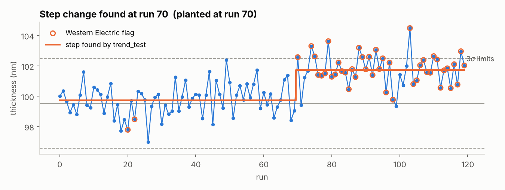
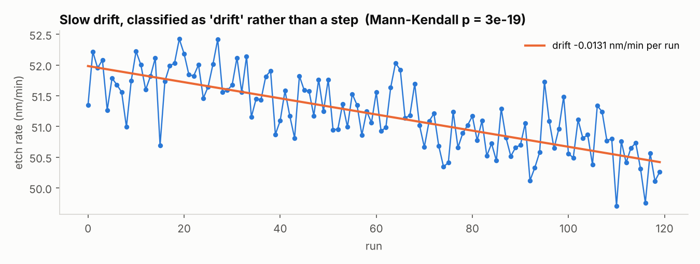
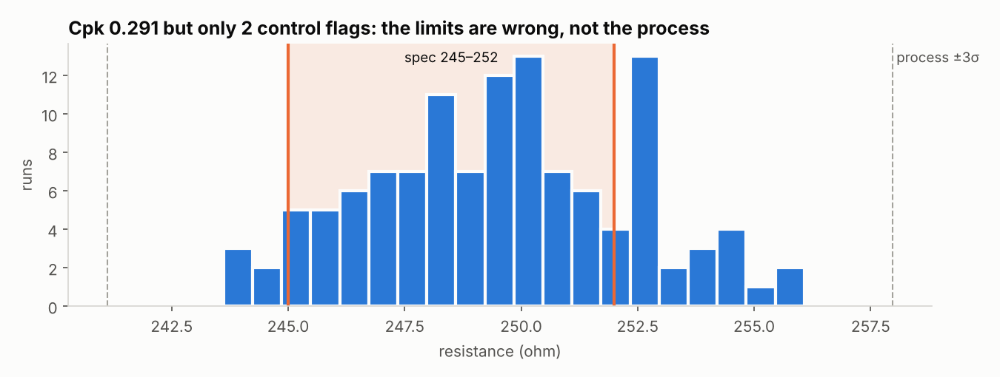
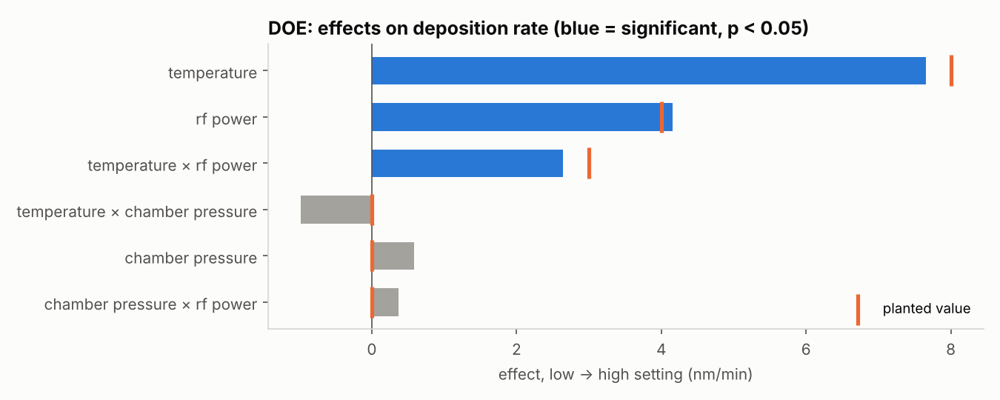

# SPC Analysis Toolkit

**Ask a production dataset questions in plain English, and get statistics you can audit.**

A process engineer asks Claude Code *"is this parameter drifting, or did it
shift?"* or *"which of these three recipe settings actually matters?"* Claude
picks the right statistical tests and explains the result, but **every number
comes from deterministic, unit-tested Python, never from the language model.**

Built by Joshua Xu (EE, UBC 2026) to bring statistical process control,
design of experiments and AI-assisted analysis together in one tool.
Developed with Claude Code as a coding assistant. [← All projects](../README.md)

| | |
| --- | --- |
| **Statistics** | SPC control charts, Western Electric rules, Cp/Cpk, two-level factorial DOE, correlation, drift-vs-step trend testing, windowed yield |
| **AI integration** | Exposed to Claude Code over MCP (Model Context Protocol); the model orchestrates, Python computes |
| **Validation** | 32 checks against faults planted at known values; all pass. 48 automated tests |
| **Stack** | Python, pandas, NumPy, SciPy, Matplotlib, MCP |

## What makes it different

**The model never does arithmetic.** Ask a language model for a Cpk and it
will be right most of the time and confidently wrong some of the time, with
nothing to tell you which. Here, the model only decides *which* tool to run, on
*which* parameter, in *what* order, and interprets the pattern across results.
Every figure in an answer traces back to a function call that can be rerun,
and gives the same output every time.

**It is validated, not just written.** The test data has faults deliberately
planted at known sizes. Each tool must recover them within a tolerance derived
from the estimate's standard error. The figures below are generated from the
tools' own output by `docs/make_figures.py`.

## Results

### Telling a sudden shift from a slow drift

Both trip control-chart rules, but they have different root causes: a step
points to an event (maintenance, a new material lot), a drift to wear or
build-up. `trend_test` separates them.





### Catching spec limits that are wrong

A Cpk of 0.29 looks like a failing process. But the control chart shows only
2 weak flags in 120 runs: the process is stable, and the 7-ohm spec window is
simply narrower than its natural spread. Reading the two tools together points
at the limits, not the process. This is a mistake real engineers make.



### Design of experiments

A replicated 2³ factorial: three recipe settings, each at a high and low
level, every combination run four times. `factorial_analysis` recovered both
planted main effects and the temperature × RF power interaction, and correctly
found chamber pressure to have no effect.



### Validation summary

| Planted fault | Planted | Recovered |
| --- | --- | --- |
| Thickness step change | +1.8 at run 70 | step, +1.98 at run 70 |
| Etch rate slow drift | −0.0135 per run | drift, −0.0131 per run |
| DOE: temperature effect | +8 | +7.65 (p = 7e-12) |
| DOE: temperature × RF power | +3 | +2.64 (p = 0.0003) |
| DOE: chamber pressure (inert) | 0 | +0.58, not significant |
| Implant dose vs sheet resistance | r = −0.80 | r = −0.83 |
| Resistance fail rate vs spec | 30% | 28% |

Full output, 32 checks: `python tests/validate.py`

## How it works

```
  You ──question──▶ Claude Code ──tool call──▶ spc_server.py (MCP) ──▶ spc_tools.py
                         ▲                                                   │
                         └──────────── JSON result (exact numbers) ──────────┘
```

- `spc_tools.py`: the statistics, as pure functions that return JSON
- `spc_server.py`: describes each tool to the model, including *when* it is worth calling
- `make_data.py`: generates the test data with faults planted at known values
- `tests/`: unit tests on hand-worked examples, plus the validation harness

## Run it

Requires Python 3.10+ and [Claude Code](https://code.claude.com).

```
cd spc-toolkit
pip install -r requirements.txt
claude
```

`.mcp.json` loads the tools automatically; type `/mcp` to confirm `spc` is
connected. Then ask, for example: *"load process_data.csv and tell me which
parameter is least stable, and why."*

To check everything without Claude: `python -m unittest discover -s tests`.
